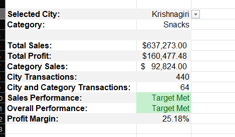
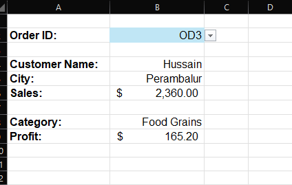

# Grocery Sales Analysis

An Excel project that analyzes grocery sales and profit by city and product category and retrieves transaction details by Order ID.

## Sales Analysis

Select a city and category to review total sales, total profit, category sales, transaction counts, performance against targets, and profit margin.

## Order Lookup

Select an Order ID to retrieve the customer name, city, sales, product category, and profit.

## Skills Used

| Skill | Implementation |
| --- | --- |
| SUMIFS / COUNTIFS | Calculated city-level and category-level sales, profit, and transaction counts |
| IF / AND | Evaluated sales and profit against performance targets |
| IFERROR | Handled potential formula errors |
| XLOOKUP | Retrieved customer, city, and sales information using Order IDs |
| INDEX / MATCH | Retrieved product categories and profit using Order IDs |
| FILTER | Returned transactions matching selected city and category |
| UNIQUE / SORT | Generated distinct city and category lists |
| Power Query | Imported the dataset and verified data types |
| Data Validation | Created dropdowns for report inputs |
| Conditional Formatting | Improved report readability and highlighted performance results |

## Project Files

- [Excel workbook](Supermart%20Grocery%20Sales%20-%20Retail%20Analytics%20Dataset.xlsx): analysis reports and source data.
- [CSV dataset](Supermart%20Grocery%20Sales%20-%20Retail%20Analytics%20Dataset.csv): transaction data used in the project.
- `Sales_Analysis_image.png`: sales report screenshot.
- `Order_Lookup_Image.png`: order lookup screenshot.

## How to Use

1. Download the Excel workbook and open it in Microsoft Excel with support for XLOOKUP, FILTER, and UNIQUE.
2. Use the city and category dropdowns in the sales report to explore performance.
3. Choose an Order ID in the lookup report to view transaction details.
